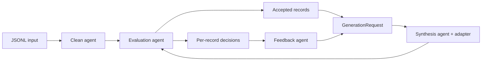

# Datawheel

A small, inspectable data flywheel: **import → clean → synthesize → evaluate/select → feedback → repeat**.

Datawheel uses four deterministic local agents with typed requests and saved handoff artifacts. A synthesis adapter produces candidates; a separate evaluation policy decides what enters the dataset. Failure reasons change the next round's sampling budget and reach the generator as structured feedback.

The default example is a fictional inventory/support-tool conversation workflow. It runs offline, makes no API calls, and deliberately injects errors so the feedback loop is observable. Its repair rule is hand-written. The reported pass-rate change is a fixture result, not evidence of model learning or autonomous LLM collaboration.

## Quickstart

Python 3.11 or later. There are no runtime dependencies; packaging uses setuptools.

```sh
git clone https://github.com/txxxxz/datawheel.git
cd datawheel
python3 -m venv .venv
. .venv/bin/activate
python -m pip install .
datawheel run --input examples/tool_dialogues.jsonl --output runs/dialogue --rounds 2
datawheel report runs/dialogue
```

Use a fresh output directory for a new experiment. The defaults are seed `7`, 12 generated candidates and at most 8 selected candidates per round.

With the shipped fixture and defaults:

| Observation | Round 1 | Round 2 |
| --- | ---: | ---: |
| Inventory generation budget | 6 | 8 |
| Ticket-status generation budget | 6 | 4 |
| Inventory candidates rejected for an incorrect tool result | 3 | 0 |
| Total candidates passing the exact evaluator | 9 / 12 | 12 / 12 |

The input contains 10 records: 3 are admitted and 7 rejected with recorded reasons. Two rounds export 19 records: the 3 admitted seeds and 16 selected synthetic records. `rounds/0002/request.json` shows the actual feedback consumed in round 2. Holding the random seed and budget constant while changing only feedback also changes generated results; the tests verify that causal connection.

## What the roles exchange



| Role | Responsibility | Output |
| --- | --- | --- |
| Clean agent | Strip outer whitespace, normalize Unicode NFC, reject empty text and exact duplicates | Normalized records, rejection reasons, changed IDs |
| Synthesis agent | Give accepted examples, group budgets, seed and previous feedback to the adapter; attach lineage | Candidate records and request hash |
| Evaluation agent | Independently validate the task, deduplicate, apply a score threshold, select deterministically | A decision for every candidate and selected records |
| Feedback agent | Accumulate generation failures by group and reason; compute next-round weights | Structured feedback consumed by the next request |

The single-process coordinator passes these typed messages and commits their artifacts. These roles have distinct policies and observable handoffs; they do not run separate services or LLM conversations. `messages.jsonl` records the sender, recipient, message kind and payload artifact. The generator never decides admission.

## Contracts and policy

Each input line is a JSON object:

```json
{"id":"example-1","group":"addition","prompt":"2 + 3","response":"5","metadata":{}}
```

`id`, `group`, `prompt` and `response` are required strings. IDs must be unique; IDs and groups must be nonempty without outer whitespace. `metadata` and `provenance` are optional JSON objects. Unknown top-level fields, invalid JSON or duplicate IDs fail the import with a location. Blank prompt/response values are valid input records that the cleaner rejects with `empty_text`. Blank lines are ignored.

The cleaner preserves internal whitespace and original IDs. Import provenance records the source SHA-256 and line number; any supplied provenance is retained under `original`. Exact deduplication compares normalized `group`, `prompt`, `response` **and the complete metadata object**. It is not semantic deduplication: records with different metadata can both pass.

An adapter has `name`, `version`, `mode`, and two methods:

```python
def generate(self, request: GenerationRequest) -> list[Candidate]: ...
def evaluate(self, record: Record) -> Verdict: ...
```

`GenerationRequest` contains the round index, derived random seed, exact per-group allocation, accepted examples, and structured `Feedback` including failure reasons. Return exactly the requested candidate count for each group. Every candidate must reference at least one supplied example through `parent_ids`. The coordinator assigns stable IDs and rejects collisions. Treat requests and their nested objects as read-only.

`Verdict` contains `passed`, a finite score from 0 to 1, and a nonempty reason. Evaluation must be deterministic and independent of the generator's claims. Passing records below `--min-score` are rejected. Selection sorts by descending score, then ascending record ID, up to `--keep`; passing records outside this limit get `selection_limit` and do not count as rule failures. The bundled exact validators use scores 0 and 1; they do not pretend to measure nuanced language quality.

For each group, the next weight is `1 + 3 × cumulative failed / attempted`. Every group gets one sample. The remaining budget is distributed proportionally using largest remainder, with alphabetical tie breaking. This deliberately simple policy spends more generation effort on groups with failures. It is not an optimizer, and persistently impossible groups can consume extra budget. Only generated-candidate failures affect this policy; seed cleaning failures are reported separately.

The dialogue fixture also reads `tool_result_mismatch` from feedback and switches to a deterministic repair strategy. [Example details](examples/README.md) explain the synthetic tool world, exact checks and deliberately bad inputs.

## Use your own data or model

Convert your data to the record contract, then supply a small Python adapter. [examples/custom_adapter.py](examples/custom_adapter.py) is a complete independent example; it requires no pipeline edits:

```sh
PYTHONPATH=examples datawheel run \
  --input examples/uppercase.jsonl --output runs/custom \
  --adapter custom_adapter:UppercaseAdapter
```

For your model, replace `generate()` with your own generation code and map its output to `Candidate`. Include `request.feedback` and the allocated groups in the model request if generation should adapt to previous failures. Keep `evaluate()` as an independent rule set or deterministic evaluator appropriate to your task. The shipped adapters make no paid calls and no provider integrations are configured automatically. An adapter is ordinary trusted Python code; it runs with your process permissions.

Set `mode` accurately, and update `version` whenever model weights, prompts, model settings, helper code, tools or external dependencies affecting output change. The manifest automatically hashes the adapter class's source file; it does **not** discover every imported helper, remote model version or environment setting. Those are your adapter's versioning responsibility. Unexpected adapter errors propagate; there is no fallback generator.

For the small arithmetic diagnostic:

```sh
datawheel run --input examples/arithmetic.jsonl --output runs/arithmetic \
  --adapter datawheel.adapters:ArithmeticAdapter
```

## Outputs and recovery

```text
runs/dialogue/
  manifest.json             # Input, engine, adapter identity and generation config
  seed/                     # Admitted seeds, cleaning/validation decisions and report
  rounds/0001/
    request.json            # Exact examples, allocation and feedback given to generation
    generated.jsonl         # All candidates, including rejected ones
    decisions.jsonl         # Rule outcome, score, selection and reason per candidate
    selected.jsonl          # Newly admitted synthetic records
    feedback.json           # Cumulative failures, reasons and next weights
    report.json             # Round counts and next allocation
    messages.jsonl          # Explicit role handoffs and artifact references
    commit.json             # Artifact hashes and previous-commit hash
  dataset.jsonl             # Admitted seeds plus selected records from all rounds
  summary.json              # Machine-readable quality report
  report.md                 # Human-readable quality report
```

Each seed/round directory is written privately and atomically renamed into place. Committed stages are checkpoints; recovery verifies their content hashes and chain before using them. A process interruption can leave a hidden temporary directory, which recovery ignores. Completed rounds are never regenerated; a missing export is rebuilt from checkpoints.

Extend the total round count with the same input and settings:

```sh
datawheel run --input examples/tool_dialogues.jsonl --output runs/dialogue \
  --rounds 3 --resume
```

The input content hash, engine code, adapter identity and generation settings must match. A changed source/config/version is a new experiment requiring a fresh output directory. The total requested rounds may increase. Source files are read only. Use one writer per output directory and keep the input fixed while a run is active. This provides local process-interruption recovery; it is not a distributed transaction system or a promise about power-loss durability.

The shipped adapters reproduce every artifact byte-for-byte with the same settings and source. A remote nondeterministic generator may produce different results when an **uncommitted** round is retried; already committed rounds remain fixed. Checkpoints detect accidental changes, not adversarial tampering by someone able to rewrite the full hash chain.

## Development and limits

```sh
python -m unittest discover -s tests -v
# Or, without installing:
PYTHONPATH=src python3 -m unittest discover -s tests -v
```

Tests cover actual feedback-driven allocation, a controlled feedback intervention, exact tool checks, lineage, deterministic selection, unchanged input, two interruption boundaries, byte-identical recovery, changed-source/checkpoint rejection, and a separate custom adapter. GitHub Actions runs the tests and dialogue demo on Python 3.11 and 3.14.

The current implementation holds datasets and request snapshots in memory, so it targets small local experiments. It has no distributed workers, model training, semantic deduplication or built-in privacy filter. The dialogue evaluator supports its documented templates and fictional tool world, not arbitrary natural-language intent. Choose independent task-specific validation before admitting real data.

See [GOAL.md](GOAL.md), the [runtime decision](docs/adr/001-runtime.md), [verification evidence](docs/verification.md), and [AGENTS.md](AGENTS.md). The repository's [coding skill](.agents/skills/readable-pipeline-code/SKILL.md) guides coding agents; it is not a runtime plugin. Code and newly authored synthetic examples are provided under the [MIT license](LICENSE); [release scope](docs/release-audit.md) and the [license comparison](docs/adr/002-license.md) explain the boundaries.
